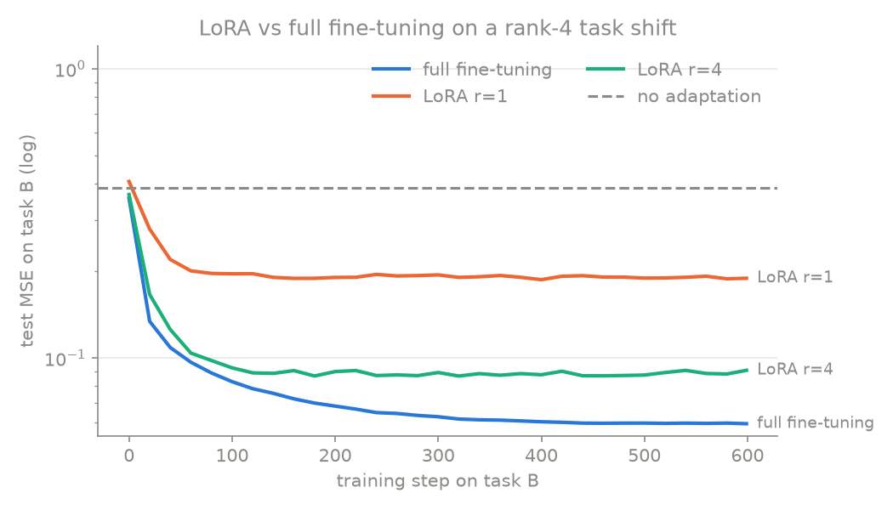

**English** | [Русский](README.ru.md)

# claude-ml-skills

Claude skills for machine learning work: turn papers into code you can read, run and trust.

[](LICENSE)
[](skills/paper-to-code/SKILL.md)
[](examples)

## paper-to-code

Give Claude an ML paper (arXiv link, ID or PDF). You get back two things:

1. **A breakdown you can learn from**: TL;DR, the problem, the core idea, the key equations with tensor shapes and section numbers, a step-by-step walkthrough, simplifications, gotchas, and three self-check questions.
2. **A minimal PyTorch implementation**: one `main.py` that runs on a laptop CPU in about a minute with no downloads. It includes tests (shapes, overfitting one batch, a method-specific property) and a demo that prints real numbers.

The skill is strict about honesty. It reads the actual paper, never reconstructs it from memory. It marks every assumption, and it never claims a toy run reproduces the paper's results.

It answers in the language you write in. Code stays in English.

## Examples

Both examples were generated with this skill and then run. The explanations are in Russian.

| Paper | Toy result | |
|---|---|---|
| [**LoRA**](examples/lora) ([arXiv 2106.09685](https://arxiv.org/abs/2106.09685)) | LoRA r=4 closes 90% of the gap to full fine-tuning with 13× fewer trainable parameters | [breakdown](examples/lora/breakdown.md) · [code](examples/lora/main.py) |
| [**Transformer**](examples/transformer) ([arXiv 1706.03762](https://arxiv.org/abs/1706.03762)) | 100% accuracy on sequence reversal in 1000 steps; demo of why attention divides by √d_k | [breakdown](examples/transformer/breakdown.md) · [code](examples/transformer/main.py) |

<p align="center">
  
  
</p>

Run an example:

```bash
cd examples/lora
pip install -r requirements.txt
python main.py
```

See the [test report](examples/TEST_REPORT.md) for what was checked and how the skill was improved along the way.

## Install

**claude.ai**

1. Download [`skills/paper-to-code`](skills/paper-to-code) and zip the `paper-to-code` folder.
2. Go to **Settings → Capabilities → Skills**, choose **Upload skill**, and select the zip.

**Claude Code**

```bash
git clone https://github.com/ame-ml-ai/claude-ml-skills.git
cp -r claude-ml-skills/skills/paper-to-code ~/.claude/skills/
```

Restart Claude Code. The skill loads automatically when you share a paper.

## Usage

```text
Here is a paper: https://arxiv.org/abs/2106.09685
Explain it and implement the core idea in PyTorch.
```

Other modes:

- `quick` gives only the TL;DR, core idea and equations.
- `code only` gives just the implementation.
- Ask it to "publish to GitHub" and it prepares a repo with a README, results plot and citation, after confirming the name and visibility.

## Roadmap

- **pytorch-debugger** — find shape errors, NaNs and silent training bugs step by step.
- **eval-builder** — design and write evaluation suites for ML models.
- **kazakh-ml-glossary** — consistent Kazakh translations of ML terms for explanations and docs.

## Contributing

Issues and pull requests are welcome: bug reports from real papers, new example papers, or new skills. To add an example, follow the layout in [`examples/`](examples) and include the actual run output.

## License

[MIT](LICENSE). The example breakdowns describe the original papers. Credit belongs to their authors, cited in each breakdown.
