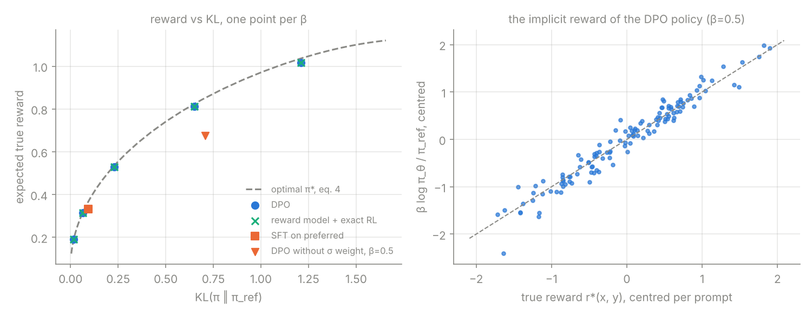

**English** | [Русский](breakdown.ru.md)

# Direct Preference Optimization: Your Language Model is Secretly a Reward Model

**Paper:** Rafael Rafailov, Archit Sharma, Eric Mitchell, Stefano Ermon, Christopher D. Manning, Chelsea Finn (Stanford). NeurIPS 2023. [arXiv:2305.18290](https://arxiv.org/abs/2305.18290), v1 29 May 2023. Read: v3, 29 Jul 2024 (HTML and PDF: §1–5, Appendices A and B). §6 and Appendices C–D were read only in part; they cover the LLM experiments and do not affect the implementation.
**Code:** [`main.py`](main.py)

## TL;DR

RLHF fits a reward model to human preferences and then runs RL (PPO) against it with a KL penalty to the reference model. DPO shows that the KL-constrained optimum has a closed form, so the reward can be written in terms of the policy itself. Plugging that into the reward-model loss gives one classification-style loss on the policy: no reward model, no sampling, no RL. On sentiment, summarisation and dialogue it matches or beats PPO-based RLHF (§6).

## Problem

The RLHF pipeline (§3) has three stages: SFT, reward modelling, and RL fine-tuning with PPO. The RL stage is the expensive and fragile one: it samples from the policy during training, needs a value function and careful tuning, and keeps the policy, reference, reward model and value model in memory.

## Core idea

The RL stage solves a known problem: maximise reward minus $\beta \cdot \mathrm{KL}$ to $\pi_{\text{ref}}$. Its optimum is $\pi_{\text{ref}}$ re-weighted by $\exp(r/\beta)$. Read backwards, any policy defines a reward, $\beta \log \frac{\pi}{\pi_{\text{ref}}}$, up to a per-prompt constant. Preferences under the Bradley-Terry model depend only on reward *differences*, so that constant cancels. You can then fit the reward model *through* the policy, and the policy you end up with is already the RL solution.

**Difference from the baseline:** RLHF = fit $r_\phi$ (Eq. 2), then RL on $r_\phi$ (Eq. 3). DPO = minimise Eq. 7 directly on the policy, with the same data.

## Key equations

**1. Bradley-Terry preferences** (§3, Eq. 1) and the reward-model loss (Eq. 2):

$$p^*(y_1 \succ y_2 \mid x) = \sigma\big(r^*(x, y_1) - r^*(x, y_2)\big), \qquad \mathcal{L}_R = -\mathbb{E}\big[\log \sigma(r_\phi(x, y_w) - r_\phi(x, y_l))\big]$$

- code: `make_preferences` (sampling labels), `train_reward_model`

**2. KL-constrained objective** (§3, Eq. 3) and **its optimum** (§4, Eq. 4):

$$\max_{\pi} \; \mathbb{E}_{x, y \sim \pi}\big[r(x, y)\big] - \beta\, \mathbb{D}_{\mathrm{KL}}\big[\pi(y \mid x) \,\|\, \pi_{\text{ref}}(y \mid x)\big]$$

$$\pi_r(y \mid x) = \frac{1}{Z(x)}\, \pi_{\text{ref}}(y \mid x) \exp\!\Big(\frac{1}{\beta} r(x, y)\Big), \qquad Z(x) = \sum_y \pi_{\text{ref}}(y \mid x) \exp\!\Big(\frac{1}{\beta} r(x, y)\Big)$$

- code: `optimal_policy`. With a discrete response set, $Z(x)$ is a sum over 8 responses, so the RL step can be solved exactly. That is what makes this toy useful.

**3. Reward from the policy** (§4, Eq. 5): $r(x, y) = \beta \log \frac{\pi_r(y \mid x)}{\pi_{\text{ref}}(y \mid x)} + \beta \log Z(x)$.

**4. The DPO loss** (§4, Eq. 7):

$$\mathcal{L}_{\text{DPO}} = -\mathbb{E}_{(x, y_w, y_l)}\left[\log \sigma\left(\beta \log \frac{\pi_\theta(y_w \mid x)}{\pi_{\text{ref}}(y_w \mid x)} - \beta \log \frac{\pi_\theta(y_l \mid x)}{\pi_{\text{ref}}(y_l \mid x)}\right)\right]$$

- code: `dpo_loss`

**5. Its gradient** (§4, "What does the DPO update do?"; unnumbered):

$$\nabla_\theta \mathcal{L}_{\text{DPO}} = -\beta\, \mathbb{E}\Big[\sigma\big(\hat r_\theta(x, y_l) - \hat r_\theta(x, y_w)\big)\big(\nabla_\theta \log \pi(y_w \mid x) - \nabla_\theta \log \pi(y_l \mid x)\big)\Big], \quad \hat r_\theta = \beta \log \frac{\pi_\theta}{\pi_{\text{ref}}}$$

- the weight is large when the implicit reward orders the pair wrongly. The paper notes that dropping it "can cause the language model to degenerate" (Appendix Table 3).
- code: checked against autograd in `test()`; the version without the weight is `unweighted_loss`

## How it works step by step

1. Start from a reference policy $\pi_{\text{ref}}$ (in the paper, the SFT model).
2. Sample two responses $y_1, y_2 \sim \pi_{\text{ref}}(\cdot \mid x)$ per prompt and label which one is preferred (§4, "DPO outline").
3. Initialise $\pi_\theta = \pi_{\text{ref}}$. At this point both log-ratios are 0, so the loss is exactly $\ln 2$.
4. For each pair compute $\beta(\log \pi_\theta - \log \pi_{\text{ref}})$ for $y_w$ and $y_l$ and minimise $-\log \sigma(\text{difference})$.
5. The gradient raises $\log \pi(y_w)$, lowers $\log \pi(y_l)$, and weights each pair by how wrong the current implicit reward is.
6. At the end, $\beta \log \frac{\pi_\theta}{\pi_{\text{ref}}}$ is a reward model, and $\pi_\theta$ is the optimal policy for it.

## Implementation

### Setup

The toy is a contextual bandit where every quantity in the paper can be computed exactly.

- 16 prompts, 8 possible responses each. $\pi_{\text{ref}}$ is a random softmax per prompt; the true reward $r^*(x, y) \sim \mathcal{N}(0, 1)$.
- 20 000 preference pairs: $x$ uniform, $y_1 \ne y_2$ sampled from $\pi_{\text{ref}}$, the winner drawn from Bradley-Terry with $r^*$ (Eq. 1).
- The policy is tabular: one logit per (prompt, response), initialised at $\pi_{\text{ref}}$. This makes the policy class contain $\pi^*$, so any gap to $\pi^*$ comes from the loss and the data, not from the model.
- $\beta = 0.5$. The ground truth is $\pi^* \propto \pi_{\text{ref}} \exp(r^*/\beta)$ (Eq. 4), computed exactly.
- Compared, all on the same data:
  - **DPO** (Eq. 7);
  - **reward model + exact RL**: fit a tabular $r_\phi$ with Eq. 2, then take the exact optimum of Eq. 3 for $r_\phi$ (Eq. 4). This is RLHF with a perfect RL step;
  - **SFT on preferred** (the paper's "Preferred-FT"): maximise $\log \pi(y_w \mid x)$;
  - **DPO without the σ weight**: the same update direction with weight 1.

```bash
pip install -r requirements.txt
python main.py          # tests + experiment + assets/results.png
python main.py --test   # tests only
```

Output (Linux, 2 CPU cores, Python 3.13, PyTorch 2.14.1; `python main.py` takes 25 s wall time, tests included):

```
tests passed (overfit loss 3.7e-03)
16 prompts, 8 responses, 20000 preference pairs sampled from π_ref, β=0.5

policy                      KL(π‖π*)  KL(π‖π_ref)   E[r*]  min log π
π_ref                         0.8801        0.000   0.059       -5.3
SFT on preferred              0.4233        0.092   0.333       -5.8
DPO, no σ weight              0.3536        0.706   0.675     -204.8
reward model + exact RL       0.0238        0.650   0.812      -10.1
DPO                           0.0238        0.650   0.812      -10.1
optimal π*                    0.0000        0.658   0.828       -9.9

max |log π_DPO - log π_RM+RL| = 1.1e-02
implicit reward vs r*, both centred per prompt: correlation 0.976, rmse 0.186
rmse on responses with π_ref < 0.05: 0.271, on the rest: 0.134
total time 20.7s
saved results.png
```



### What the numbers show

- **DPO lands on the optimal frontier.** For every β tried (4 to 0.25), the DPO policy sits on the curve traced by the exact optimum $\pi^*_\beta$ (left panel). At β = 0.5 it reaches expected reward 0.812 against 0.828 for $\pi^*$, and $\mathrm{KL}(\pi \| \pi^*) = 0.024$, 37× closer to $\pi^*$ than $\pi_{\text{ref}}$ is.
- **DPO and "reward model + exact RL" give the same policy.** They agree to 4 decimals on every metric, and their log-probabilities differ by at most 0.011. This is the paper's main claim in its sharpest form: with a policy class that can represent $\pi^*$, minimising Eq. 7 is the same maximum-likelihood problem as Eq. 2 followed by Eq. 3, just parameterised through $\pi$. The remaining gap to $\pi^*$ (0.024) is estimation error from finite data, and both methods share it.
- **The policy is a reward model.** $\beta \log \frac{\pi_\theta}{\pi_{\text{ref}}}$, centred per prompt, has correlation 0.976 with the true reward (right panel). Centring is needed because rewards are identified only up to $f(x)$ (Definition 1, Lemmas 1–2). The error is 2× larger on responses that $\pi_{\text{ref}}$ rarely samples (RMSE 0.271 vs 0.134): they appear in fewer comparisons.
- **The σ weight matters.** Without it the loss is linear in the log-ratios and has no minimum: the log-probability of every response that loses more comparisons than it wins goes to $-\infty$ (−204.8 after 2000 steps, and still falling linearly). The policy ends up below the frontier (reward 0.675 at KL 0.71, where the optimal frontier reaches about 0.85). This is the toy version of "can cause the language model to degenerate".
- **SFT on preferred** improves on $\pi_{\text{ref}}$ but has no β to trade reward for KL: it stays at one point (KL 0.09).

This is a bandit with 128 possible outputs, not a language model. It verifies the algebra and the estimator. It does **not** reproduce the paper's results on IMDb, TL;DR or Anthropic HH.

### Tests (`test()`)

- **shapes**, and $y_w \ne y_l$ in every pair;
- **loss at init is exactly $\ln 2$** when $\pi_\theta = \pi_{\text{ref}}$;
- **gradient:** autograd equals the paper's gradient formula. For a tabular policy, the $\pi(\cdot \mid x)$ terms in $\nabla \log \pi(y_w) - \nabla \log \pi(y_l)$ cancel, so the formula reduces to $\pm\beta\sigma(\cdot)$ at the two entries;
- **Lemmas 1 and 2:** $r + f(x)$ gives the same preference probabilities and the same optimal policy;
- **Eq. 5:** $\beta \log \frac{\pi^*}{\pi_{\text{ref}}} + \beta \log Z(x)$ recovers $r^*$ exactly;
- **Eq. 4 is the optimum of Eq. 3:** the objective at $\pi^*$ equals $\beta\, \mathbb{E}_x \log Z(x)$, and 20 random perturbations of $\pi^*$ all score lower;
- **overfit:** on 4 pairs the DPO loss goes below 0.05 in 300 steps.

## Simplifications

- **No language model.** Responses are 8 discrete actions, so $\log \pi(y \mid x)$ is one log-softmax entry, not a sum of token log-probs. Everything the paper derives (Eqs. 1–7, Lemmas 1–2) holds at this level.
- **Tabular policy.** It can represent any policy, including $\pi^*$. A real LM cannot, and generalisation across prompts and responses matters there.
- **Known $\pi_{\text{ref}}$ and fresh samples from it.** In the paper, preference data often comes from another model, and $\pi_{\text{ref}}$ is then fit by SFT on the preferred completions (§4) to reduce the distribution shift.
- **Distinct pairs.** $y_2$ is resampled until it differs from $y_1$. The paper does not discuss ties.
- **Optimiser.** *Assumption:* full-batch Adam, lr 0.05, 2000 steps. The paper uses RMSprop, lr $10^{-6}$, batch 64, 150 warmup steps (Appendix B), tuned for LLMs.
- **β.** *Assumption:* 0.5 as the main value. The paper's default is 0.1 and 0.5 for TL;DR (Appendix B); the right value depends on the reward scale, which is arbitrary in a toy.

## Gotchas

- **The reference log-probs are constants.** Compute them once with the frozen $\pi_{\text{ref}}$ and never backpropagate through them.
- **Initialise $\pi_\theta$ at $\pi_{\text{ref}}$.** Then the first loss is $\ln 2 \approx 0.693$. A different first loss means the log-probs or the reference are wrong. This is the DPO version of "check the loss at step 0".
- **Rewards are only defined up to $f(x)$** (Definition 1). Compare implicit rewards to anything only after centring per prompt, or compare differences within a prompt.
- **Keep the σ weight.** Without it the objective is unbounded (see the −204.8 above). The paper reports degeneration for this variant (Appendix Table 3).
- **Rarely sampled responses get poor reward estimates.** Pairs are drawn from $\pi_{\text{ref}}$, so a response that $\pi_{\text{ref}}$ almost never produces is rarely compared, and its implicit reward is noisier (2× the error here). If $r^*$ is high there, $\pi^*$ wants mass there, and DPO's estimate of how much is the least reliable.
- **Deterministic preferences break the KL anchor.** If $y_w$ always beats $y_l$, the loss is minimised only as the log-ratio difference goes to $\infty$, whatever β is. With finite data the same happens to a response that won every comparison it appeared in. Azar et al. (2023, "IPO") analyse this failure mode.
- **β multiplies the gradient.** With a fixed learning rate, a smaller β also means smaller steps. When sweeping β, re-tune or at least check convergence.

## Check yourself

1. Why does the partition function $Z(x)$, which is intractable for an LM, not appear in the DPO loss?
2. What is the DPO loss at the very first step, and why?
3. In the toy, DPO and "reward model + exact RL" give the same policy. Why would you expect them to differ with a real language model?

<details>
<summary>Answers</summary>

1. Bradley-Terry depends only on $r(x, y_w) - r(x, y_l)$. Writing each reward with Eq. 5, both terms contain the same $\beta \log Z(x)$ for the same prompt, and it cancels (Eq. 6).
2. $\ln 2$. With $\pi_\theta = \pi_{\text{ref}}$ both log-ratios are 0, so the loss is $-\log \sigma(0) = \log 2$.
3. In the toy, the policy class contains $\pi^*$ and the RL step is exact, so both methods solve the same maximum-likelihood problem. With an LM, PPO only approximates the RL optimum (sampling, value estimates, finite steps), and the policy and reward networks have different inductive biases and generalise differently to unseen prompts and responses.

</details>
