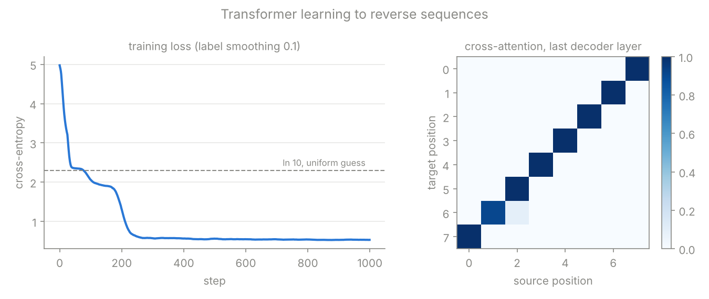

**English** | [Русский](breakdown.ru.md)

# Attention Is All You Need

**Paper:** Ashish Vaswani, Noam Shazeer, Niki Parmar, Jakob Uszkoreit, Llion Jones, Aidan N. Gomez, Łukasz Kaiser, Illia Polosukhin. [arXiv:1706.03762](https://arxiv.org/abs/1706.03762), v1 12 Jun 2017. Read: v7, 2 Aug 2023 (HTML). The appendix with attention visualisations was not read in full; it does not affect the implementation.
**Code:** [`main.py`](main.py)

## TL;DR

Before 2017, machine translation was built on recurrent networks that process tokens one at a time and parallelise poorly. The Transformer removes recurrence and convolutions and builds the encoder-decoder from attention and feed-forward layers only. It trains faster and translates better: 28.4 BLEU on WMT14 EN-DE (Table 2).

## Problem

An RNN computes $h_t$ from $h_{t-1}$, so the steps of one sequence cannot run in parallel. A signal between distant positions passes through $O(n)$ steps, and long-range dependencies are hard to learn (§1, §4, Table 1). Attention already existed, but as an add-on to RNNs.

## Core idea

Every position asks every other position how relevant it is and takes a weighted sum of them. A query is compared with keys, and the values are summed with those similarity weights. Any two positions are one step apart, and all positions are computed in parallel. Word order comes from a positional encoding added to the inputs.

**Difference from the baseline:** an RNN encoder-decoder with attention is replaced by an encoder-decoder where attention is the *only* mechanism that mixes positions.

## Key equations

**1. Scaled dot-product attention** (§3.2.1, Eq. 1):

$$\mathrm{Attention}(Q, K, V) = \mathrm{softmax}\!\left(\frac{QK^\top}{\sqrt{d_k}}\right) V$$

- $Q \in \mathbb{R}^{B \times h \times T_q \times d_k}$, $K \in \mathbb{R}^{B \times h \times T_k \times d_k}$, $V \in \mathbb{R}^{B \times h \times T_k \times d_v}$
- $\sqrt{d_k}$: if the components of $q$ and $k$ are independent with variance 1, $q \cdot k$ has variance $d_k$ (the footnote in §3.2.1), and without the division softmax saturates
- masking (§3.2.3): illegal positions are set to $-\infty$ before the softmax
- code: `attention`

**2. Multi-head attention** (§3.2.2):

$$\mathrm{MultiHead}(Q,K,V) = \mathrm{Concat}(\mathrm{head}_1, \dots, \mathrm{head}_h)\, W^O, \quad \mathrm{head}_i = \mathrm{Attention}(QW_i^Q, KW_i^K, VW_i^V)$$

- $W_i^Q, W_i^K \in \mathbb{R}^{d_{model} \times d_k}$, $W_i^V \in \mathbb{R}^{d_{model} \times d_v}$, $W^O \in \mathbb{R}^{hd_v \times d_{model}}$, $d_k = d_v = d_{model}/h$
- code: `MultiHeadAttention`. All $h$ matrices $W_i^Q$ live in one `w_q` of size $d_{model} \times d_{model}$, and `split` cuts the result into heads. A test checks this against an explicit loop over heads.

**3. Position-wise FFN** (§3.3, Eq. 2): $\mathrm{FFN}(x) = \max(0,\, xW_1 + b_1)\, W_2 + b_2$
- code: `FeedForward`

**4. Positional encoding** (§3.5):

$$PE_{(pos,\,2i)} = \sin\!\left(pos / 10000^{2i/d_{model}}\right), \qquad PE_{(pos,\,2i+1)} = \cos\!\left(pos / 10000^{2i/d_{model}}\right)$$

- code: `positional_encoding`

**5. Residual sub-layer** (§3.1, §5.4): $\mathrm{LayerNorm}(x + \mathrm{Dropout}(\mathrm{Sublayer}(x)))$, i.e. post-LN.
- code: `EncoderLayer.forward`, `DecoderLayer.forward`

**6. Learning-rate schedule** (§5.3, Eq. 3):

$$lrate = d_{model}^{-0.5} \cdot \min\!\left(step^{-0.5},\; step \cdot warmup\_steps^{-1.5}\right)$$

- code: `lrate`, `train`

## How it works step by step

The task in the code is reversing a sequence of 8 digits: `[4,0,3,4,0,1,9,4] → [4,9,1,0,4,3,0,4]`.

1. **Encoder input.** Tokens go through a shared embedding table, are multiplied by $\sqrt{d_{model}}$, get $PE$ added, then dropout (`embed_tokens`).
2. **Encoder:** $N$ identical layers of self-attention (every position sees every position) and FFN, each sub-layer wrapped in $\mathrm{LayerNorm}(x + \cdot)$.
3. **Decoder input:** the target shifted right by one, `[BOS, y_1, …, y_7]` (`make_batch`).
4. **Decoder:** $N$ layers with three sub-layers:
   - (a) masked self-attention: position $i$ sees only positions $\le i$ (`causal_mask`);
   - (b) cross-attention: queries from the decoder, keys and values from the encoder output;
   - (c) FFN.
5. **Output.** Hidden states times the transposed embedding matrix (shared weights, §3.4) give the logits.
6. **Training step.** Cross-entropy with label smoothing $\varepsilon_{ls} = 0.1$; Adam with $\beta_1 = 0.9$, $\beta_2 = 0.98$, $\epsilon = 10^{-9}$; learning rate from Eq. 3 (§5.3).
7. **Inference.** Greedy decoding from `BOS` (`greedy_decode`). The paper uses beam search with width 4.

## Implementation

```bash
pip install -r requirements.txt
python main.py           # tests + demo + training + assets/results.png (~35 s)
python main.py --test    # tests only
python main.py --ablate  # also three ablations (~2 min 15 s)
```

Output of `python main.py --ablate` (Linux, 2 CPU cores, Python 3.13, PyTorch 2.14.1; without `--ablate` the run takes 35 s, tests included):

```
tests passed (overfit loss 4.6e-03)
d_k=4   mean max attention weight: unscaled 0.49, scaled 0.31
d_k=16  mean max attention weight: unscaled 0.73, scaled 0.32
d_k=64  mean max attention weight: unscaled 0.86, scaled 0.32
params 166592, loss at step 1 4.97 (ln 11 = 2.40), final train loss 0.540
test: token accuracy 1.000, sequence accuracy 0.999
example: [8, 0, 9, 9, 6, 3, 6, 0] -> [0, 6, 3, 6, 9, 9, 0, 8]
decoder layer 1 cross-attention on the mirrored source position, per head: 0.93 0.26 0.13 0.40 (uniform = 0.12)
decoder layer 2 cross-attention on the mirrored source position, per head: 0.99 1.00 0.99 0.99 (uniform = 0.12)
total time 27.8s
saved results.png

ablations, 1000 steps each, same seed
change                   token acc  seq acc  final loss
none                         1.000    0.999       0.540
no positional encoding       0.214    0.000       1.491
no 1/sqrt(d_k)               1.000    1.000       0.537
no warmup                    0.097    0.000       2.334
```



### What the numbers show

- **The model learns the alignment, not just the answer.** Target position $i$ has to copy source position $T-1-i$. In the second decoder layer all 4 cross-attention heads put 0.99–1.00 of their weight on that mirrored position (uniform attention would give 0.12). That is the anti-diagonal in the right panel. In the first layer one head out of four does it (0.93).
- **A plateau at $\ln 10$.** The loss first drops to about $\ln 10 = 2.30$: the model has learned that the answer is one of 10 digits but not which one. Around step 200 (the end of warmup) the alignment appears and the loss drops again.
- **Training.** With $N = 2$, $d_{model} = 64$, $h = 4$ the model reverses 999 of 1000 new sequences without a mistake after 1000 steps (token accuracy rounds to 1.000).
- **The final loss is about 0.54, not 0,** because label smoothing does not let the model put probability 1 on a token.
- **Why divide by $\sqrt{d_k}$.** For random unit-variance $q, k$ and 10 keys, the mean max attention weight without scaling grows with $d_k$: 0.49 → 0.73 → 0.86, and softmax becomes almost one-hot. With scaling it stays near 0.32. This is the argument of the paper's footnote.

**Ablations** (`--ablate`; each changes one thing, same seed, 1000 steps):

- **No positional encoding:** token accuracy 0.214. That is almost exactly the bag-of-tokens ceiling. A model that knows *which* digits are in the input but not *where* can at best name a digit from the input, and is right with probability $(1 + 7 \cdot 0.1)/8 \approx 0.21$. Without $PE$ the encoder is permutation-equivariant (question 3 below).
- **No $1/\sqrt{d_k}$:** nothing breaks (1.000). An honest negative result: the footnote's argument is about large $d_k$ (64 in the paper), and here $d_k = 16$. The demo above shows the effect grows with $d_k$.
- **No warmup** (the same Eq. 3 with $warmup\_steps = 1$, so the first learning rate is $d_{model}^{-0.5} = 0.125$): training collapses, token accuracy 0.097, chance level for 10 digits. Post-LN without warmup is unstable; see Gotchas.

This is a toy experiment. It shows the mechanism and does **not** reproduce the paper's BLEU.

### Tests (`test()`)

- **shapes:** `attention` returns $(B, T, d)$ and weights $(B, T, T)$; `MultiHeadAttention` returns $(B, T, d_{model})$; model logits are $(B, T, |V|)$;
- **overfit one batch:** on 8 samples, without dropout and label smoothing, the loss drops to $4.6 \times 10^{-3}$ in 200 steps;
- **method properties:**
  - every row of the attention weights sums to 1;
  - vectorised multi-head attention equals an explicit $\mathrm{Concat}(\mathrm{head}_1..\mathrm{head}_h) W^O$ (atol $10^{-5}$);
  - $PE$ matches the formula at two points;
  - **causality:** changing decoder inputs at positions 5–7 leaves outputs at 0–4 unchanged and changes 5–7.

## Simplifications

- **Scale and task.** The paper uses $N = 6$, $d_{model} = 512$, $d_{ff} = 2048$, $h = 8$ and WMT14 translation. The code uses $N = 2$, $d_{model} = 64$, $d_{ff} = 128$, $h = 4$, an 11-token vocabulary and a synthetic reversal task of fixed length 8.
- **No padding.** All sequences have the same length, so there is no encoder padding mask (`src_mask = None`). Real data needs one.
- **Warmup** is 200 steps instead of 4000, because the whole run is 1000 steps. Eq. 3 itself is unchanged.
- **Ablations** use one seed and one task. They are a demonstration, not a careful statistical comparison.
- **Embedding init.** The paper does not specify it. *Assumption:* $\mathcal{N}(0, d_{model}^{-1})$ (see Gotchas).
- **Step numbering.** The paper does not say whether $step$ starts at 0 or 1. *Assumption:* 1 ($step = 0$ divides by zero).
- **Decoding.** Greedy instead of beam search (width 4, length penalty 0.6), no checkpoint averaging (§6.1).
- **Biases.** The attention projections have no biases, as in the paper's formulas. The FFN has biases, as in Eq. 2.

## Gotchas

- **The $1/\sqrt{d_k}$ scale** (§3.2.1). Without it softmax saturates at large $d_k$, as the demo shows.
- **Mask before softmax, not after** (§3.2.3). Fill illegal positions with $-\infty$ *before* softmax; then their weight is exactly 0 and the rest still sums to 1. Zeroing weights after softmax leaves rows that sum to less than 1.
- **Shift the decoder input by one** (§3.1). Without the shift, position $i$ sees its own answer.
- **Post-LN and warmup** (§3.1, §5.3): $\mathrm{LayerNorm}(x + \mathrm{Sublayer}(x))$. Many modern implementations use pre-LN, but the paper uses post-LN, which is sensitive to the early learning rate. In the ablation without warmup the model does not learn at all (0.097).
- **Dropout in two places** (§5.4): on each sub-layer output before the residual add, and on the sum of embeddings and $PE$.
- **Shared weights and the $\sqrt{d_{model}}$ factor** (§3.4). One matrix serves the input embeddings, output embeddings and the final linear layer. With PyTorch's default $\mathcal{N}(0, 1)$ init, multiplying by $\sqrt{d_{model}}$ blows up the inputs and the initial logits are huge. Our first run started at loss 46 instead of $\ln 11 \approx 2.4$ and reached only 78% sequence accuracy after 1500 steps. With $\mathcal{N}(0, d_{model}^{-1})$ the initial loss is about 5 and accuracy reaches 100% within 1000 steps. The paper does not say whether $\sqrt{d_{model}}$ also applies to the output layer; the code applies it to inputs only.
- **Adam with $\beta_2 = 0.98$** (§5.3), not the default 0.999.

## Check yourself

1. What happens to the gradients if you drop the $\sqrt{d_k}$ division with $d_k = 512$?
2. Why does the decoder need both the mask and the one-position shift? Isn't one enough?
3. Without positional encoding, how does the encoder output change if you permute the input tokens?

<details>
<summary>Answers</summary>

1. The dot products have variance around 512, so softmax gives almost all weight to one key. The softmax gradient is near zero in saturation, so $W^Q$ and $W^K$ barely learn.
2. The shift puts $y_{i-1}$ at input position $i$ while we predict $y_i$. The mask stops position $i$ from looking at positions $> i$, which hold $y_i, y_{i+1}, \dots$. Without the mask the model would see the answer at the next input position; without the shift, at its own.
3. The outputs are permuted in the same way: self-attention and the FFN are permutation-equivariant. The model cannot tell "dog bites man" from "man bites dog". The ablation shows the consequence: accuracy falls to the bag-of-tokens ceiling.

</details>
